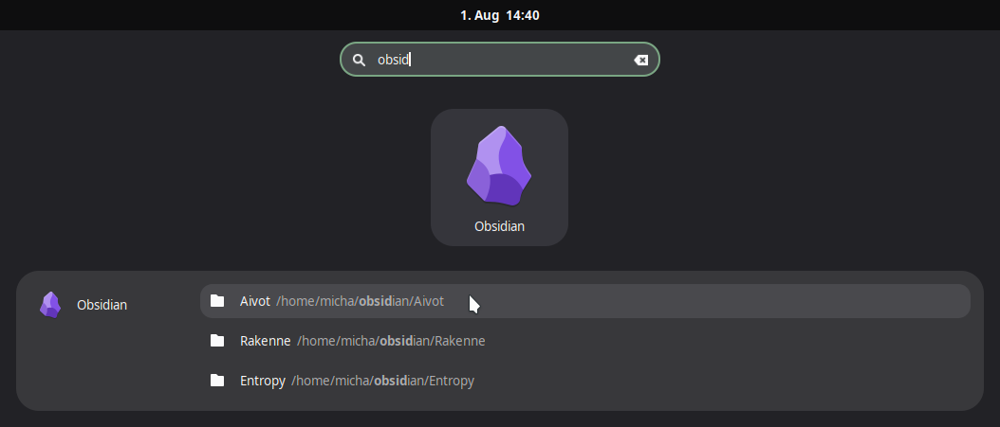

# Obsidian GNOME Search Provider

A GNOME Shell search provider for [Obsidian](https://obsidian.md). It integrates your Obsidian vaults into the GNOME
activity overview, allowing you to quickly find and launch them.

## Usage



After installation and reloading of the search providers simply type in the name of your vault to open it directly in
obsidian.

To list of all your registered vaults type `obsidian` or `vault`. The results display the name of the vault as well as
its path.

It reads `~/.config/obsidian/obsidian.json` to list all registered vaults.

## Installation

### Arch Linux

You can install this package from the AUR:

```bash
yay -S obsidian-gnome-search-provider
```

### Manual Installation

To install it manually across other distributions, run:

```bash
sudo make install
```

- Make sure you have the required dependencies:
    - `python3`
    - `python-gobject`
    - `obsidian`

After installation, you may need to restart the GNOME Shell by logging out and back in, for GNOME to pick up the new
search provider.

## Troubleshooting

Logs are written to the system journal since this acts as a D-Bus service. You can inspect logs using:

```bash
journalctl --user --since today | grep obsidian-search-provider
```

## Development

To configure the development environment:

1. Install [uv](https://docs.astral.sh/uv/).
2. Sync the project and dependencies:
   ```bash
   uv sync
   ```
3. Set up `pre-commit` to automatically run checks before you commit:
   ```bash
   uv run pre-commit install
   ```
4. Run the linters and type-checkers manually:
   ```bash
   make lint
   ```
5. Auto-format the code:
   ```bash
   make format
   ```

### Install Local Version (Arch Linux)

If you are developing on Arch Linux, the best way to install and test your local changes without bypassing the package
manager is to use `makepkg`:

```bash
makepkg -si
```

This will package your local repository files into a `.pkg.tar.zst` and cleanly install it using `pacman`. To rebuild
and overwrite an existing local installation, you can use `makepkg -si --force`.

If you modify the python script (`obsidian-search-provider.py`) and reinstall it, GNOME Shell will continue to use the
old background process until it is stopped. To force D-Bus to load your new version on the next search without logging
out, kill the existing process:

```bash
pkill -f obsidian-search-provider
```
